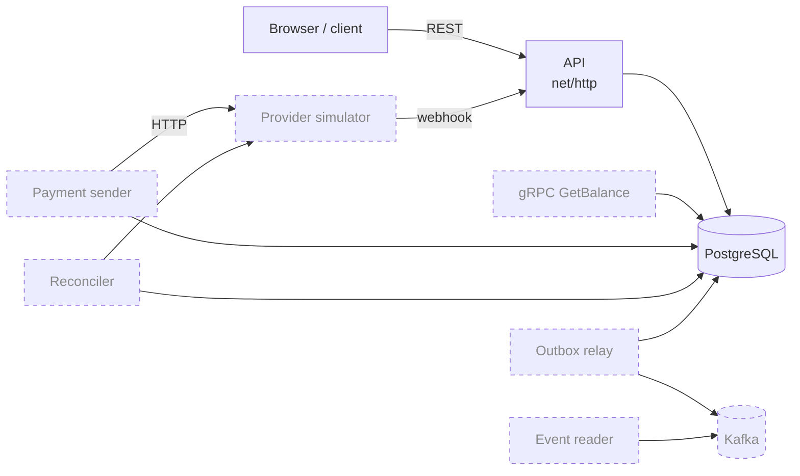

# payment-ledger

[](https://github.com/Kasamael/payment-ledger/actions/workflows/ci.yml)

A small payment service in Go that shows how to keep money correct under concurrency and retries: double-entry
ledger, ordered row locks, idempotency keys — with a demo page where you can trigger the race yourself.
The money is fake.

**Status:** slice 1 of 6 is done — accounts, deposits, transfers, idempotent API, demo page, integration tests.
Payouts through an unreliable provider, gRPC and Kafka are designed below and marked *planned*.

Live demo: *coming soon* · Stack: Go, `net/http`, `pgx`, PostgreSQL, goose, Docker

## Try it in 60 seconds

```bash
docker compose up -d --build --wait
```

Open <http://127.0.0.1:8095/>. You are Petya.

1. **Accounts** → *Deposit* 100 €.
2. **Transfer** → amount 80 € → *Send twice at once*.
   Two transfers hit the server at the same moment: exactly one gets `201`, the other `422 insufficient funds`.
   Petya has 20 €, never −60 €.
3. *Retry same key* → `201` with the **same `operation_id`**. The server replayed the saved response; no second
   transfer happened.
4. Switch to **Masha** at the top: 80 € and one `transfer` line in her statement.

The same from the command line:

```bash
P='X-User-ID: 11111111-1111-1111-1111-111111111111'
curl -s -X POST -H "$P" -H 'Idempotency-Key: d1' -d '{"amount":10000}' \
  http://127.0.0.1:8095/accounts/a0000000-0000-0000-0000-000000000001/deposits
curl -s -X POST -H "$P" -H 'Idempotency-Key: t1' \
  -d '{"from_account_id":"a0000000-0000-0000-0000-000000000001","to_account_id":"a0000000-0000-0000-0000-000000000002","amount":8000}' \
  http://127.0.0.1:8095/transfers
```

Run the second command again: same answer, same `operation_id`, balance unchanged.

## Architecture



Solid boxes exist today, dashed ones are planned. One binary (`cmd/ledger`) will run all jobs as goroutines in an
`errgroup` with a shared `context`: one job fails or SIGTERM arrives — all stop. Jobs talk only through the database.
The provider simulator is a separate binary, so timeouts and dropped connections go through a real network.

## Design decisions

| # | Problem | Decision | Why not otherwise | |
|---|---|---|---|---|
| 1 | A bare balance number can't explain where money came from | Double entry: an immutable **operation** with **postings** that sum to zero; `accounts.balance` is a cache updated in the same transaction | One "from → to" row breaks on a three-party fee; `float` loses cents; summing postings on every transfer is slow | built |
| 2 | 100 € on the account, two 80 € transfers in the same second | One transaction: `SELECT … FOR UPDATE` on both accounts **in ascending id order**, check the balance in Go, write postings | Optimistic versions loop on a hot account; `SERIALIZABLE` retries everything; `sync.Mutex` breaks with two instances | built |
| 3 | The connection dropped, the client retries the transfer | `Idempotency-Key`: key, work and saved response in one transaction; refusals are saved too | A key column on `operations` remembers only successes | built |
| 4 | The provider answers in seconds or never | Payout returns `202 accepted`; a worker calls the provider outside the transaction | Holding a transaction open holds a pool connection and the account lock | planned |
| 5 | We sent 50 € and got no answer | Statuses `accepted → sent / unknown → succeeded / failed / needs_review`; conditional `UPDATE … WHERE status IN (…)`; a reconciler asks the provider with backoff | "Timeout = failure" returns money that may have left; "timeout = resend" may pay twice | planned |
| 6 | Payment saved, process dies before Kafka | Transactional outbox, one relay under `pg_try_advisory_lock`, partition key = account | Several relays with `SKIP LOCKED` break ordering; Debezium is too heavy for a Raspberry Pi | planned |
| 7 | Decisions 2, 3, 5 rely on exact SQL and Postgres error codes | `pgx` directly, hand-written SQL, one `inTx` helper: `lock_timeout`, rollback, retry on `40P01`/`40001` | An ORM hides the SQL these decisions depend on; `sqlc` later, past ~30 queries | built |
| 8 | A slow provider must not slow down transfers | Workers pull from the DB (`FOR UPDATE SKIP LOCKED`), own `http.Client` with timeouts, retries only for status queries, own circuit breaker | A goroutine per payment is unbounded and dies with the process | planned |
| 9 | Browsers, the provider and internal services need different transports | REST outside, gRPC inside, one core; errors mapped in one place | Only gRPC needs grpc-web for the browser; only REST loses the internal contract | REST built, gRPC planned |
| 10 | Reviewers skim READMEs | Demo page built into the binary with `embed`, one screen per problem | A React app adds npm and a build step for one page | built |

### 1. Double entry

Money never appears or disappears; it moves. Every change is an operation plus postings that sum to zero:

| Operation | Postings |
|---|---|
| deposit 100 € | `outside` −100, Petya +100 |
| transfer 30 € | Petya −30, Masha +30 |
| payout hold / success / failure *(planned)* | Petya −50, `frozen` +50 / `frozen` −50, `outside` +50 / `frozen` −50, Petya +50 |

Operations and postings are never updated or deleted; a mistake is fixed by a reverse operation. Money is `bigint`
in cents. `frozen` and `outside` are system accounts, one per currency; they have no cached balance and are never
locked, otherwise every payout would queue behind one row.

### 2. Ordered row locks

```go
first, second := fromID, toID
if second < first {
	first, second = second, first // always lock the smaller id first
}
a1, err := lockAccount(ctx, tx, first)  // SELECT … FOR UPDATE
a2, err := lockAccount(ctx, tx, second)
```

Petya→Masha and Masha→Petya at the same moment both start from the smaller id, so the second simply waits — no
circular wait, no deadlock. `inTx` still retries `40P01`/`40001` as a safety net, and `CHECK (balance >= 0)` is the
last line of defence.

The tests prove it both ways: with the code as is, 50 + 50 crossing transfers all succeed; with the ordering removed,
Postgres reports over a hundred deadlocks and the test fails.

### 3. Idempotency keys

```text
BEGIN
  INSERT INTO idempotency_keys … ON CONFLICT DO NOTHING
  0 rows → key known: same request hash → return saved response; other hash → 422
  1 row  → run the transfer, save status + body next to the key
COMMIT
```

- A concurrent duplicate waits on the insert until the first transaction ends, then reads its response. No
  "in progress" state is needed because an uncommitted row is invisible.
- A refusal (`422 insufficient funds`) is a saved response and the transaction commits. Otherwise a retry after
  money arrives would succeed — a different answer to the same request.
- A technical failure is an error: it rolls back together with the key, so a retry runs again.
- `23505` is not caught: after any error a Postgres transaction is aborted (`25P02`) and the saved response could not
  be read in it anyway.

## API

| Request | What it does | |
|---|---|---|
| `GET /healthz` | process is alive (does not touch the DB) | built |
| `GET /readyz` | ready: DB answers, otherwise `503` | built |
| `GET /accounts` | accounts of the user from `X-User-ID` | built |
| `GET /accounts/{id}` | one account with balance | built |
| `GET /accounts/{id}/postings` | statement, newest first, last 50 | built |
| `POST /accounts/{id}/deposits` | test deposit, `Idempotency-Key` required | built |
| `POST /transfers` | transfer, `Idempotency-Key` required | built |
| `GET /` | demo page | built |
| `POST /payments` | payout to a card, `202` | planned |
| `GET /payments/{id}` | payout status | planned |
| `POST /webhooks/provider` | provider notifications, HMAC-signed | planned |
| `GET /events` | event feed for the demo page | planned |

| Core error | REST | gRPC *(planned)* |
|---|---|---|
| not found, or someone else's account (not revealed) | 404 | `NotFound` |
| insufficient funds, currency mismatch | 422 | `FailedPrecondition` |
| idempotency key reused with a different request | 422 | `InvalidArgument` |
| invalid input, missing `Idempotency-Key` | 400 | `InvalidArgument` |
| anything else (logged, not shown) | 500 | `Internal` |

The user is taken from the `X-User-ID` header and trusted — a demo assumption, see *Not done*.

## Data model

| Table | Key columns | Constraints | |
|---|---|---|---|
| `users` | `id`, `first_name`, `last_name` | | built |
| `accounts` | `id`, `user_id` (null for system), `type` (`user`/`system`), `code` (`frozen`/`outside`), `currency`, `balance` (null for system) | owner+balance for user accounts, code and no balance for system; `balance >= 0`; one user account per currency; one system account of each kind per currency | built |
| `operations` | `id`, `type` (`deposit`, `transfer`, `payout_*`) | never updated | built |
| `postings` | `operation_id`, `account_id`, `amount` (negative = debit) | `amount <> 0`; index `(account_id, id)` for statements | built |
| `idempotency_keys` | PK `(user_id, key)`, `request_hash`, `response_code`, `response_body` | | built |
| `payments`, `providers`, `webhook_inbox`, `outbox` | | | planned |

Migrations live in `internal/postgres/migrations` and run on start (goose, embedded). `00002_seed.sql` creates the
demo data:

| Who | user id | EUR account |
|---|---|---|
| Petya | `11111111-1111-1111-1111-111111111111` | `a0000000-0000-0000-0000-000000000001` |
| Masha | `22222222-2222-2222-2222-222222222222` | `a0000000-0000-0000-0000-000000000002` |
| `frozen` | — | `f0000000-0000-0000-0000-000000000001` |
| `outside` | — | `f0000000-0000-0000-0000-000000000002` |

## Running and testing

| What | Where |
|---|---|
| REST and demo page | host `127.0.0.1:8095` → container `:8080` |
| PostgreSQL | host `127.0.0.1:5433` → container `:5432`, user/password/db `app`/`app`/`ledger` (local only) |

Environment: `DATABASE_URL` (required), `HTTP_ADDR` (default `127.0.0.1:8095`), `SHUTDOWN_TIMEOUT` (default `10s`).

```bash
go test -race ./...
```

Integration tests run against a real PostgreSQL: by default the one from `docker compose` on port 5433, or set
`TEST_DATABASE_URL`. If no database is reachable they are **skipped**, not failed. They create their own users with
random ids and delete everything afterwards, so the demo data is never touched. CI runs them against a PostgreSQL
service container.

```text
cmd/ledger/               the service
cmd/provider-sim/         fake payment provider (planned, slice 3)
internal/config/          environment
internal/httpapi/         REST handlers, idempotency plumbing
internal/ledger/          domain types and errors
internal/postgres/        pool, migrations, SQL, transactions; integration tests
internal/web/             demo page, embedded
```

## Not done

Honest limits of the current version:

- **No authentication.** `X-User-ID` is trusted. On a public address anyone can act as Petya or Masha with fake money.
- **"Postings sum to zero" is enforced by code, not by the database.** A deferred constraint trigger would close it.
- Idempotency keys are not cleaned up yet (planned: delete after 24 hours).
- The saved response is stored as `jsonb`, so a replay has the same content but may differ in key order and spaces.
- No reconciliation against a provider's daily report and no UI for `needs_review` (both after slice 4).

## Roadmap

| Slice | What | |
|---|---|---|
| 1 | Accounts, deposits, transfers with ordered locks, idempotency keys, demo page, integration tests | ✅ |
| 2 | gRPC `GetBalance`: deadlines, interceptors, health, reflection | |
| 3 | Provider simulator, payouts, payment statuses | |
| 4 | Reconciler, HMAC webhooks, circuit breaker | |
| 5 | Outbox → Kafka, event feed on the demo page | |
| 6 | Prometheus metrics, Grafana dashboard | |

Each slice ends with a deploy of the demo and a line in this README.
